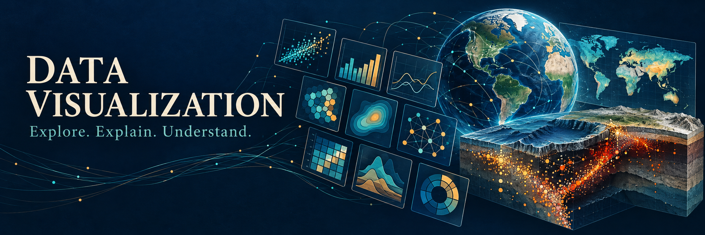

# Data Visualization

Learn to choose a visual form, inspect how it is constructed, and explain what
it communicates. Read the rendered examples here, then change the code in a
Python notebook running in your browser.

[**Open the notebook in JupyterLite Lab**](https://jltobias.github.io/JupyterLite-Data-Visualization/lab/index.html?path=visualization_methods_v2.ipynb&reset)
 · [Project home](https://jltobias.github.io/JupyterLite-Data-Visualization/)
 · [Source repository](https://github.com/jltobias/JupyterLite-Data-Visualization)

## Start with a question

1. **Choose a task.** Are you comparing amounts, following change, exploring
   relationships, explaining a process, or discussing a strategy?
2. **Read an example.** Find a relevant method in the catalog and inspect its
   code and output. The catalog uses generated teaching data, not observations
   about real people or programs. Many concept and strategy examples are
   simplified diagrams rather than complete implementations of those methods.
3. **Explain the encoding.** Identify what position, length, area, color, and
   connections represent. Check axes and units before interpreting a pattern.
4. **Make a change.** Open the lab, run setup, then change a value, label, or
   visual form. Describe how that change affects your interpretation.
5. **Compare alternatives.** Ask which view makes the question easier to answer
   and what context, uncertainty, or missing information would matter.

## Read, run, and save

The book displays notebook outputs prepared during publication. In the lab,
select the Python (Pyodide) kernel and run the setup cell before the examples.
The first package download can take time. Start with one section rather than
running the entire catalog at once.

JupyterLite saves edits in your browser. Download a notebook to keep a copy
outside that browser; editing in the lab does not update the GitHub repository.
The launch link opens a newly named release copy without deleting your older
saved notebooks. If an old tab still shows the removed poster, close that tab
and use the launch link above.

## About the framework

Ralph Lengler and Martin J. Eppler's *Periodic Table of Visualization Methods*
organizes visual approaches into data, information, concept, strategy, metaphor,
and compound families. This project's catalog is an educational adaptation,
not an exact reproduction or an exhaustive classification. The authors' original
graphic is available through the source link in [References and attribution](references.md).

The splash is original AI-generated conceptual cover art. Its map and underground
scene are illustrative; they are not measured geographic or earthquake data.
The larger open-data curriculum, maps, and storymap described in the draft
project plan remain future work; this book publishes the existing catalog.
